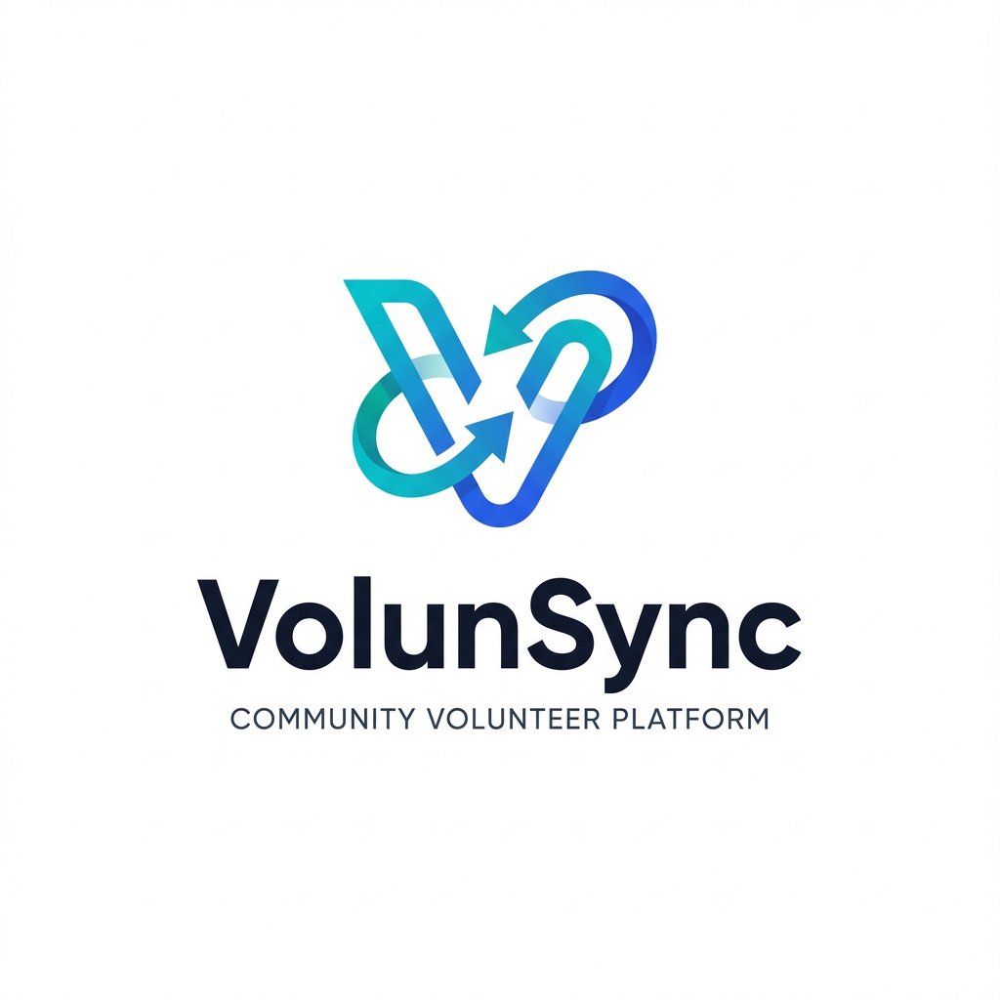

<p align="center">
  
</p>

<h1 align="center">VolunSync — System Management for Volunteer Events</h1>

<p align="center">
  <strong>Unified platform for community volunteer recruitment, division screening, automated workspaces, overlap-free shift scheduling, and QR + GPS attendance verification.</strong>
</p>

<p align="center">
  
  
  
  
  
</p>

---

## Context & Competition

* **Project Name:** VolunSync (*System Management for Volunteer Event*)
* **Competition:** STACK 2026 by GDGoC ITB — *Case 2: Stronger Communities and Everyday Services*
* **Team:** **Perempatan Gatsu** (Ronald Ramadhani Pangestu, Azka Kurnia Akbar, Alif Fathi Athallah Ramadhan Sya'roni, Alice Restituta Cynthia Dewi)
* **Architecture:** Single Modern Monolith (Laravel + Inertia.js v3 + React 19 + TypeScript + Tailwind CSS v4 + Dens-UI)

---

## Progress Saat Ini (Priority 1 — MVP Complete)

Seluruh fitur inti **Priority 1 (MVP)** beserta penyempurnaan UX multi-organisasi & multi-event telah selesai dibangun dan terverifikasi:

### 1. Landing Page & Public Explorer
- **Editorial Landing Page (`/`):** Desain putih bersih bergaya arsitektural dengan grid background, **Motion for React** (`motion/react`) scroll progress & parallax, animated counters dari database, daftar event aktif, Role Access Passes, dan FAQ accordion.
- **Event Explorer (`/events`):** Katalog per-event dengan pencarian & filter status (`All`, `Ongoing`, `Open`), halaman detail event yang menampilkan kuota tiap divisi, dan modal pengajuan aplikasi relawan.

### 2. Multi-Organization Onboarding & RBAC
- **Registrasi Publik 2-Role (`/register`):**
  - **Volunteer (`volunteer`):** Registrasi standar untuk relawan.
  - **Organizer (`organizer`):** Wajib mengisi `organization_name` (dan opsional `organization_description`). Setiap Organizer terisolasi penuh hanya mengelola event & divisinya sendiri (`events.organizer_id`).
- **Provisioning Coordinator Khusus Organizer (`/admin/coordinators`):**
  - Tidak ada self-registration publik untuk Coordinator.
  - Organizer dapat membuat akun Coordinator baru (`created_by_organizer_id`), mengedit profil/reset password, mengatur divisi yang dipegang, assign user yang sudah ada, atau menghapus/unassign Coordinator.
- **Case-Insensitive Login (`/login`):** Pencocokan email `LOWER(email)` via Fortify.

### 3. Volunteer Console (Dedicated Sidebar)
- **Sidebar Khusus Volunteer (`VolunteerLayout`):** Memisahkan menu lintas-event (`Explore Events`, `My Applications`, `My Workspaces`) dengan daftar **Accepted Divisions** di sidebar agar relawan yang diterima di 2+ event tetap terisolasi rapi per divisi.
- **Live Status Timeline (`/volunteer/applications`):** Progres status real-time (`Submitted` → `Under Review` → `Accepted` / `Rejected`) lengkap dengan catatan reviewer.
- **Multi-Event Workspaces Hub (`/volunteer/workspaces`):** Daftar semua divisi yang diterima dengan deteksi otomatis apabila ada event yang tanggalnya beririsan.
- **Per-Division Workspace (`/volunteer/workspace/{division}`):**
  - **Overview & Briefings:** Pengumuman divisi & kontak Coordinator.
  - **Peer Directory:** Direktori sesama anggota divisi yang diterima.
  - **Shifts & QR Check-In:** Jadwal shift divisi + scanner kamera QR (`html5-qrcode`) & GPS proximity check-in/check-out langsung di dalam konteks event & divisi terkait.
  - **Documents (`P2` Ready):** Tab arsip dokumen dengan filter `Event-Wide` vs `<Division> Only` (schema & scoping siap untuk Priority 2).

### 4. Organizer & Coordinator Admin Console (`/admin/*`)
- **Dashboard (`/admin/dashboard`):** Ringkasan KPI scoped per Organizer atau per Coordinator + slot placeholder Priority 2.
- **Events & Divisions (`/admin/events`):** CRUD Event (dengan koordinat GPS venue & radius check-in geofence) serta CRUD Divisi, kuota, penugasan Coordinator, dan pengumuman workspace.
- **Screening Portal (`/admin/applications`):** Alur **2-level Event-First** (Event Overview Grid dengan progres kuota & badge pending → Focused Event Screening Queue dengan Division Quick-Filter Pills, Status Filter Tabs, **TanStack Table v8**, serta modal review dengan CV privat, kontak pelamar, dan validasi kuota divisi).
- **Shifts & QR Codes (`/admin/shifts`):** Pembuatan shift dengan `qr_token` unik, tampilan modal SVG QR code (`bacon/bacon-qr-code`), dan penugasan relawan yang dijaga oleh **`ShiftConflictService`** (**0% double-booking** lintas divisi maupun lintas event).
- **Attendance Logs (`/admin/attendance`):** Validasi radius GPS server-side menggunakan rumus **Haversine** (`AttendanceVerificationService`), penghitungan otomatis `verified_hours` saat check-out, dan tombol force check-out admin.

### 5. Priority 2 (Reserved for Final Day — 16 December 2026)
- Migrasi tabel `documents`, tab `Documents (P2)` per divisi, dan placeholder UI di Dashboard & Sidebar sudah siap.
- Upload/download file via Laravel Storage, antrean email asinkron (`Laravel Mail & Queues`), serta chart analitik lanjutan akan diaktifkan pada sesi Final Day.

---

## Tech Stack

| Layer | Technology |
| :--- | :--- |
| **Backend** | Laravel 13, PHP 8.3+, Eloquent ORM, Laravel Fortify, Spatie Laravel Permission |
| **Frontend Bridge** | Inertia.js v3, Laravel Wayfinder |
| **Frontend UI** | React 19, TypeScript, Tailwind CSS v4, Dens-UI v0.2.0 (`Figtree` & `JetBrains Mono`) |
| **Animation & Data** | Motion (`motion/react`), TanStack Table v8, Lucide React |
| **QR & Geolocation** | `bacon/bacon-qr-code` (SVG QR), `html5-qrcode`, HTML5 Geolocation API + Haversine |
| **Database** | SQLite (default lokal) / MySQL / PostgreSQL |

---

## Tata Cara Instalasi (Local Setup)

### Prasyarat
- **PHP** >= 8.3 & **Composer**
- **Node.js** >= 20 & **npm**

### Langkah Instalasi

```bash
# 1. Clone repository
git clone https://github.com/LilAlamin/VolunSycn.git
cd VolunSycn

# 2. Install dependensi PHP & JavaScript
composer install
npm install

# 3. Salin file environment & generate application key
cp .env.example .env
php artisan key:generate

# 4. Siapkan database SQLite (atau sesuaikan DB_* di .env untuk MySQL/PostgreSQL)
touch database/database.sqlite

# 5. Jalankan migrasi & seeder (105+ relawan, 5 event, 2 organisasi, shift & log)
php artisan migrate --seed

# 6. Build aset frontend
npm run build
```

### Menjalankan Server Development

```bash
composer run dev
```

Buka **`http://127.0.0.1:8000`** di browser.

---

## Akun Demo (Hasil Seeder)

Password untuk semua akun demo: **`password`**

| Role | Email | Cakupan Akses |
| :--- | :--- | :--- |
| **Organizer (Org 1)** | `organizer@volunsync.test` | Kelola event & divisi organisasi 1, provisioning coordinator |
| **Organizer (Org 2)** | `organizer2@volunsync.test` | Isolasi penuh organisasi 2 |
| **Division Coordinator** | `coordinator@volunsync.test` | Screening, shift, QR & absensi khusus divisi yang ditugaskan |
| **Volunteer** | `volunteer@volunsync.test` | Explorer, timeline lamaran, workspace divisi & QR check-in |

---

## Verifikasi & Testing

```bash
# Jalankan seluruh unit & feature test (47 tests, 180 assertions)
php artisan test

# Cek tipe TypeScript
npm run types:check

# Build produksi
npm run build
```

